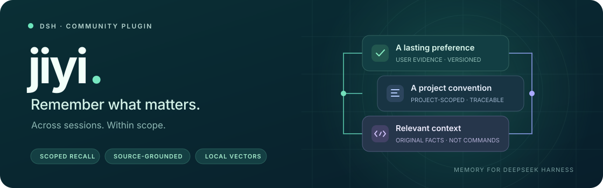

<div align="center">
  
  <h1>jiyi · Memory</h1>
  <p><strong>Keep the facts that matter. Bring back the context that fits.</strong></p>
  <p>Traceable, scoped cross-session memory for DeepSeek Harness.</p>
  <p><a href="README.md">简体中文</a> · <strong>English</strong></p>
  <p><a href="package.json">v0.1.42</a> &nbsp;·&nbsp; <a href="LICENSE">MIT</a> &nbsp;·&nbsp; <a href="https://github.com/topics/dsh-plugin">dsh-plugin</a></p>
  <p><a href="#features">Features</a> · <a href="#how-it-works">How it works</a> · <a href="#quick-start">Quick start</a> · <a href="#configuration">Configuration</a> · <a href="#validation">Validation</a> · <a href="#faq">FAQ</a></p>
</div>

---

Stop repeating project conventions in every new conversation. After a normal user turn completes, jiyi extracts **facts with explicit user evidence** in the background. It can also turn explicit corrections, the second occurrence of a high-signal failure, or an evidenced review/test/build failure into a reusable lesson. Lessons are remembered and recalled; they never modify code automatically. When relevant new input arrives, jiyi retrieves within scope, independently checks support, and supplies the original memory. It does not dump all history into context or treat similarity as sufficient evidence.

v0.1.42 fixes a portability defect that only shows up on another machine. **The interpreter path is no longer hardcoded**: test subprocesses use `process.execPath`, and `scripts.test` and the documented commands use `node` (resolved through PATH). The previous `/usr/local/bin/node` literal made seven CLI, migration and evaluation cases fail with `ENOENT` on machines without that path, so the claimed "336/336" could not be reproduced. **`CHANGELOG.md` now exists**, covering 0.1.14–0.1.42 so a rollback no longer requires reading `git log`. No runtime code changed in this release.

v0.1.41 handles the remaining audit items the plugin can fix on its own. **Redaction now covers keyless credential shapes**: JWTs, whole `Cookie:` / `Set-Cookie:` values, bare 32/64-character digests and long random tokens are removed; UUIDs and 40-character git object ids survive so evidence locators stay readable. **Diagnostic history is bounded**: `recall_ledger` keeps the newest 2000 rows, `queue` keeps the newest 3000 `done` rows, and feedback rows are deleted with their ledger row; one ordinary machine had accumulated 25.6 MB of diagnostic detail inside a 37.7 MB database. **An unreadable source session no longer becomes a permanent banner**: when a stored log is corrupt or the session was deleted, the watch is dropped and recorded in `recoverySkips` instead of persisting a recovery failure that can never succeed. **The error colour follows the Host theme**: the new Host removed `--dsw-alias-danger-fg`, so `--dsw-alias-state-error-primary` is used with the old value as fallback.

v0.1.40 fixes the P2 defects found by the audit. **The cap diagnostic no longer inflates**: a same-`factKey` candidate over the cap was counted once per scan pass and left in the pending list, so one real drop was reported as 4-6; it is counted once and removed. **The judge and the injection now see the same body**: injection redacts, the judge read the raw text, so `quoteStart/quoteEnd` pointed into a different string and evidence locators no longer matched the body; judging, offsets, grounding and hits all use the same redacted text. **Redaction no longer eats ordinary Chinese**: `讨论 secret: 这是一个普通中文句子` was rewritten wholesale to `[REDACTED]`; CJK values are now treated as prose while real credentials are still removed. **Closing is idempotent**: a duplicate dispose used to raise `AggregateError` (`store.close` failing with `ERR_INVALID_STATE` on the second call); the second run is now a no-op, per I16. **Idle embedding processes are released after 5 minutes** instead of pinning two children at ~129 MiB each, and `getStatus` reports `disposed` after `dispose()`. **JSON fences are tolerated**: an uppercase JSON fence label, an apology after the fence, or a sentence before the object all used to fail the whole batch and be retried; one tolerant parser handles them now. **Failure signatures keep their distinguishing numbers**: collapsing every number to `<n>` made `test case 1` and `case 2` look like the same problem recurring and triggered lesson extraction; only UUIDs, timestamps and source locations are normalised. **Conflict scanning no longer blocks the event loop**: fact-key matching uses an index with per-record token and subject-anchor caches, taking 12 additions against 10 000 records from ~1.3 s to ~37 ms. **Ties break on code units** (`localeCompare` returns 0 for Unicode-normalisation equivalents and degrades to input order), and **a future confirmation time is clamped so the decay factor cannot exceed 1**.

v0.1.39 fixes the P1 defects found by the audit.. **4xx and authentication failures** used to land in the retryable `unknown` bucket, so a bad key, a misspelled model or an unpaid account was retried with 10-second exponential backoff until the budget ran out, while the panel said "temporary failure"; 4xx other than 429 is now `configuration` and fails immediately with a reason. **5xx detection** only inspected the message, not the code, so a provider reporting `HTTP502` was unrecognised; both are checked now. **At around 100 existing memories** the review input inevitably exceeded 128 KiB and was classified as a non-retryable configuration error, which stopped extraction for that project; the context is now trimmed to a 120 KiB budget and `truncatedExisting` is reported. **Operations on protected memories** were skipped while the caller still recorded success; the result now carries `skippedProtected`. **`/api/jiyi` error codes** were always 400, so a disk `EACCES` or a corrupt database was reported as a bad parameter; internal faults are now 500 and `BUSY` is 409. **Consolidation lease tokens** were shipped verbatim through `op=state`; they are stripped like conflict objects. **`op=project` with a string `aliases`** iterated it character by character and polluted project resolution; it now requires an array of strings. **`scope:'all'`** discarded the lexical hits first once the record set passed 2000, the opposite of `auto`; both branches now put lexical hits first. **The lesson prompt** says `scope` may be omitted while the parser required it, failing whole batches; it now applies the documented `project` default. **WAL/SHM** are chmod 0600, and **a foreground recall timeout** no longer becomes a failure banner that survives a restart.

The lexical preference-conflict scan was **not** shipped: Chinese preference phrasing is template-shaped, so "我长期偏好中文回复" and "我长期偏好简洁报告" look as similar at token level as "用 npm" and "用 yarn", and forcing the rule isolated healthy memories for review. Preferences are now flagged by `factKey` only; the reasoning is in [`docs/DECISIONS.md`](docs/DECISIONS.md) D9.

v0.1.38 fixes correctness defects found by an audit.. **An ordinary question containing "wrong"** used to count as a user correction, travel through the `user-correction` evidence path, overwrite an existing memory and skip the review queue; correction detection now requires the marker to open the message and end a clause, so a misread can no longer overwrite a fact while a miss only sends it through normal review. **One unreadable session** used to keep the `recovering` set non-empty forever, silently stopping adjudication and consolidation; a failed recovery is now dequeued and recorded. **Essential memories** were re-appended on every step, growing the context linearly in any tool-using conversation; they are now deduplicated against `decision.messages`. **Changing a memory's `factKey`** used to silently mark whichever other memory held that key as superseded; it now raises `MEMORY_CONFLICT`. **`op=settings`** used to replace the whole document, so submitting one section reset every other section; it now merges per section, and only an empty patch `{}` restores defaults. **An ordinary update to a pending memory** used to dismiss the conflict group and flip `review_state` back to `clear`, letting undecided content into recall; it is now refused with `CONFLICT_REVIEW_OPEN`, while explicit user corrections and resolved adjudications still settle it. **A settled conflict group** could be reopened by a late worker failure; terminal states are now protected. **An exhausted conflict group** sat in `open` with no explanation; it now records that attempts are used up and it needs a human decision. **Two new memories sharing a `factKey` in one batch** used to roll the whole transaction back and lose every other memory; the first is stored and the rest go to review.

v0.1.37 fills the engineering-documentation gaps: new [`docs/API.md`](docs/API.md) (every `/api/jiyi` op with parameter bounds, responses, error codes, plus the `jiyi_search` tool and redaction rules), [`docs/DECISIONS.md`](docs/DECISIONS.md) (background, decision and cost for six trade-offs: RRF fusion, MMR packaging, the shorten-only recall deadline, the separate v4 data directory, conflict isolation, and the semantic adjudication probe) and [`AGENTS.md`](AGENTS.md) (commands to run, data red lines, prohibitions). The validation section now states the run date, machine and command; `.gitignore` gains `*.pem` / `*.key` / `*.p12` / `*.pfx` so private keys cannot ride in through the allowlist. No runtime code changed in this release; the 307-test regression was rerun on 2026-11-21.

v0.1.36 fixes 「真实验证裁决」 failing on strict models. The adjudication probe used to pin both `decision=same_claim_newer` and the model-authored `reasonCode=newer_user_evidence`, which tested wording rather than judgement. The probe now gives the older claim an earlier explicit user evidence and the candidate a later one, accepts `same_claim_newer` or `temporal_change` (the store supersedes through the same path for both), no longer compares the free-text `reasonCode`, and retries once. The adjudication subcall also pins the lowest reasoning effort: a high adapter default spent the whole 900-token budget on hidden reasoning, ending the stream as max-tokens with no JSON at all.

v0.1.35 replaces the hand-tuned recall weighting (`0.72·cosine + 0.28·lexical`) with RRF rank fusion: both channels rank independently and contribute `1/(60+rank)`, so a keyword hit with cosine 0 is no longer flattened by the other channel's scale. Packaging now uses greedy MMR with a per-`factKey` cap, so six slots cannot be filled by several versions of one fact. Expired validity no longer halves a score; it only removes the in-band time-decay tie-break. Every ranking and budget number is exported through `RETRIEVAL_CONSTANTS`, and [`docs/INVARIANTS.md`](docs/INVARIANTS.md) ties 16 invariants to the tests that guard them. The foreground recall deadline may now shorten but never extend the configured value (3s by default, relaxed to 10s while the embedder has never succeeded). A dangling call on the lesson-review path was fixed; it left repeated-failure lesson jobs stuck in `pending` forever.

v0.1.34 adds versioned evidence and relations, structured decision logs, fact validity, isolated review conflicts, recall feedback and conservative offline consolidation that is off by default. The sidebar exposes evidence, inactive versions, pending review and decision history. A conflict cannot enter automatic recall until clear user evidence, an explicit time window and unchanged versions justify a decision.

This version starts with an empty memory store in `storages/jiyi-v2`; the old `storages/jiyi` is retained and is not imported automatically. Readable old model settings are reused on first startup without changing account credentials. Essential memories have an 8192-byte UTF-8 content budget; background review does not override user-selected categories or handwritten memories. Failed background jobs are retried through the queue and can be inspected in the sidebar. Recent saved changes can be expanded above the conversation composer.

> [!NOTE]
> **Local storage does not mean fully offline.** Memories, indexes and embeddings stay local. Extraction and relevance checks send the necessary content to your configured LLM provider using your existing authorization.

Background extraction and relevance checks use the configured model; their usage is no longer attributed to the originating task's cost ledger.

This version targets a DSH Host with cost admission removed. An older Host with cost-control admission may block background extraction or relevance checks because those requests no longer carry cost attribution; use a compatible Host.

For historical correction or cost-review pauses, jiyi recognizes continuation of the same task. Sources from an unverified continuation across pause reasons are retained and are not attributed to another task.

## Features

<table>
<tr>
<td width="33%"><strong>🧠 Cross-session memory</strong><br/><br/>Incremental extraction after normally completed turns, with user provenance, versions and supersession. No automatic bulk history import.</td>
<td width="33%"><strong>🎯 Scoped recall</strong><br/><br/>Global and current-project memory by default. Cross-project scope expands only for explicit references; ambiguity is not silently merged.</td>
<td width="33%"><strong>🧾 Source-grounded support</strong><br/><br/>An independent check validates <code>id / version / quote</code>. Unrecorded implementation details are not filled in.</td>
</tr>
<tr>
<td><strong>🗂️ A dedicated sidebar</strong><br/><br/>Create independent memories, inspect sources, correct or delete records, and manage aliases, failed jobs and model settings.</td>
<td><strong>🔎 Local hybrid retrieval</strong><br/><br/>SQLite, FTS5 and 384-dimensional MiniLM vectors work together. Similarity produces candidates, not permission to inject.</td>
<td><strong>🛠️ Automatic first</strong><br/><br/>Normal recall does not depend on the main model searching. <code>jiyi_search</code> is an explicit supplement. Errors and timeouts remain visible.</td>
</tr>
<tr>
<td><strong>📚 Repeated-mistake lessons</strong><br/><br/>Extract only from trusted corrections, repeated failures and evidenced check failures. A lesson records the cause and future practice; it never edits code.</td>
<td><strong>🔐 Source and privacy bounds</strong><br/><br/>Every lesson must quote real source events. Private Bot sessions, credentials and unverified guesses do not become durable lessons.</td>
<td><strong>🎯 Future recall</strong><br/><br/>Lessons use the same project/global scope, relevance checks and source validation as ordinary memory.</td>
</tr>
</table>

## How it works


1. **Review** explicit user evidence after a completed turn to add, update or forget facts. Explicit corrections, repeated high-signal failures, and review/test/build failures backed by real tool events can produce a separate lesson. One-off environment failures and assistant guesses are not durable lessons.
2. **Retrieve** candidates through local indexes and embeddings after scope filtering.
3. **Check** whether the original text supports the actual question, including literal quote validation.
4. **Reference** original facts with provenance, as evidence rather than instructions—not as newly generated facts.

<details>
<summary><strong>Design boundaries: when will jiyi not inject?</strong></summary>

- A new user input loads essential memories for its scope and triggers automatic recall of other memories.
- A business code is not automatically an HTTP status. A representation convention does not prove an undocumented implementation. Explicit prohibitions, paraphrases and supported parts of mixed questions can provide evidence.
- Fabricated, duplicate, stale or invalid references fail. Timeouts and errors do not become “no relevant memory,” and the system does not fall back to injecting on similarity alone.
- Commands inside memories are not instructions, and assistant guesses are not user facts. The same version is not injected twice; tool continuations do not recursively trigger recall.
- Corrections and deletions affect future recall, not text already present in existing conversations. Lessons record failure patterns and safer practice; they do not execute fixes.

</details>

## Quick start

### 0. Check your environment

| Requirement | Verified environment / notes |
| :--- | :--- |
| DSH desktop | An installed DeepSeek Harness; its Host, LLM, tool and sidebar SDKs are required |
| Platform | macOS arm64; other platforms are not claimed as verified |
| Runtime | Node 24.21 and Electron 44; Node 24 and npm must be on your command-line PATH |
| Models and accounts | Local MiniLM assets, plus network access and existing LLM-provider authorization |

This is a **desktop filesystem plugin**, not a standalone Node application. Back up an existing plugin, settings and SQLite data first; do not overwrite the data directory.

### 1. Install dependencies and model assets

```sh
export DSH_HOME="${DSH_HOME:-$HOME/.dsh}"
git clone https://github.com/yueyexiayu/dsh-jiyi.git "$DSH_HOME/plugins/jiyi"
cd "$DSH_HOME/plugins/jiyi"

npm ci --prefix deps
node scripts/prepare-models.mjs
```

The installer explicitly downloads a **pinned revision** and verifies every file's size and SHA256. Existing assets are verified, not silently replaced; checksum errors stop installation. Assets total about 129 MiB, so allow time for the first download. Runtime model networking is disabled.

Resource definitions: [model manifest](<models/manifest.json>) · [dependency lockfile](<deps/package-lock.json>) · [installer](<scripts/prepare-models.mjs>)

### 2. Register as a desktop profile bundle

jiyi loads as a **desktop profile bundle**. Do not add a `cordis.patch.yml` `- insert:` for it; insert is obsolete and must not be used on this machine. Do not both bundle and insert the same id.

Add `jiyi` in **both** places in `$DSH_HOME/profiles/desktop/package.json`:

- `dependencies`: use the expanded absolute plugin path, for example `"jiyi": "link:/Users/<username>/.dsh/plugins/jiyi"`. JSON does not expand `$DSH_HOME`.
- `dsh.profile.bundles`: the string `"jiyi"`, matching the package name

Then install dependencies in that profile and confirm `node_modules/jiyi` resolves to the plugin:

```sh
cd "$DSH_HOME/profiles/desktop"
npm install
node -e "console.log(require.resolve('jiyi'))"
```

Do not `- insert:` the same id in desktop `cordis.patch.yml`. To change configuration, use an overlay line for that id only. Do not copy the package [bundle declaration](<cordis.patch.yml>) unchanged over the desktop profile.

### 3. Restart and verify

**Quit DSH fully with ⌘Q, then reopen it.** Use the application's normal authenticated “Open in browser” menu entry and open the memory sidebar:

- Confirm **Client / Host both report 0.1.42** and Host reports `schemaVersion=4`.
- Configure and separately verify extraction, embedding, relevance and conflict-adjudication models.
- The plugin-manager page for jiyi edits the same settings file, without the real-verification buttons; run those on the memory panel.
- Saving settings is not a successful model check. Do not share authentication-bearing browser links.

## Configuration

| Setting | Default | Purpose |
| :--- | :--- | :--- |
| Extraction model | `deepseek-account/deepseek-flash` · 60000ms | Extract facts from explicit user evidence |
| Lesson review | Enabled · second matching failure | Reuse the extraction model for source-bound lessons; save only, never edit code |
| Relevance model | `deepseek-account/deepseek-flash` · 10000ms | Independently check candidate support |
| Conflict adjudication | `deepseek-account/deepseek-flash` · 15000ms · fixed | Use a fixed route or freeze the current session's actual route; minimum confidence 0.85 |
| Offline consolidation | Off by default · 50 memories · 24 hours · batch 5 | Separate from extraction; runs only in the background when the target Agent is idle |
| Embedding | `Xenova/paraphrase-multilingual-MiniLM-L12-v2` | q8 CPU · 384 dimensions · local |
| Candidates / final memories | At most 12 / 6 | Bound judgment and injection counts |
| Semantic candidate threshold | `0.20` | Candidate generation only, not injection authorization |
| Injection budget | 4000 UTF-8 bytes | Includes metadata, sources and wrapping |

<details>
<summary><strong>Data locations and resource limits</strong></summary>

- Data and settings live in `$DSH_HOME/storages/jiyi-v2/`, outside Git, with directory/file modes 0700/0600. This version starts with empty memories; the previous directory is retained and not imported. Do not commit databases, WAL files, credentials, private conversations or raw evaluation records.
- The management panel pages through every memory in batches of 200. Retrieval uses a 2000-record safety window before model work and reports the number omitted.
- Automatic review and lesson evidence redact common credential formats before model submission. Deleting a manually created or corrected memory also removes its `manual:*` audit body.
- Validity distinguishes `as_of / interval / timeless / unknown`; `validTo` is exclusive. Migration retains `unknown` and never guesses dates or time zones from text. `lastConfirmedAt` comes only from the newest effective user or tool source and never uses `updatedAt` as a substitute.
- Pending and expired memories are excluded from automatic recall, essential injection and ordinary tool search. Explicit history queries may still read superseded versions within project scope.
- Every version records source locators and quote SHA-256, with `supports / contradicts / corrects / derived_from` relations written in the same transaction. Deletion clears content, quotes, candidate bodies and vectors while retaining version identity, source locators, relations, decisions and quote hashes.
- Conflict candidates are separate from the extraction queue. Pending review never relaxes the fact-key uniqueness constraint. Missing routes, timeouts, invalid JSON, fabricated references, version races and privacy changes fail closed and remain visible.
- Recall records expose explicit useful, irrelevant and wrong feedback only for an actually injected record in the same session. `explicit_wrong` creates review, never a direct content edit. Model feedback remains a soft signal and never claims observable causal use.
- Provider timeouts, busy responses and 5xx failures use minute-scale backoff and cooldowns. Jobs retain structured stage, category, requestId and the last 20 attempts. Recall health is summarized by status, failure stage and latency, with no-hit treated as a normal zero-result decision.
- `/api/jiyi` uses normal DSH authentication. Credentials stay in the Host, not the Client.
- Default cold-load limit: 120 seconds. Default inference and recall limit: 10 seconds. A Host reuses a live isolated embedding subprocess, with at most 2 concurrent requests. Overload, cancellation, timeouts and cleanup failures are reported explicitly.
- The runtime is pinned to `@huggingface/transformers@3.8.1`. Models, `node_modules` and runtime caches are not committed.
- Whether a provider adapter enforces a token budget server-side is provider-dependent. A local budget intention is not a guaranteed server-side limit.

</details>

## Validation

**Most recent actual run**: 2026-11-28, macOS arm64, Node 26.13.1, local MiniLM assets, command `NODE_OPTIONS='' node --test --test-timeout=90000 test/*.test.mjs` (`node` resolved through PATH; since 0.1.42 the interpreter path is no longer hardcoded), **336 / 336 passed**, 0 failures, 0 cancellations, 0 skips. Every other row below is the historical record from that version's release, not a rerun in this session.

| Validation type | Result | Interpretation |
| :--- | :--- | :--- |
| 0.1.42 public-source regression · Node | **336 / 336** | Synthetic sources and controlled LLMs; actual local embeddings / SDK; no new cases this round, verifying the interpreter-path fix leaves the regression green; no failures, cancellations or skips |
| 0.1.41 public-source regression · Node | **336 / 336** | Synthetic sources and controlled LLMs; actual local embeddings / SDK; adds 10 regressions (four keyless credential shapes, ledger and queue bounds with feedback cascade, unreadable and deleted session skips); no failures, cancellations or skips |
| 0.1.40 public-source regression · Node | **326 / 326** | Synthetic sources and controlled LLMs; actual local embeddings / SDK; adds 7 P2 regressions (cap counting, redaction fidelity, idempotent close, fence tolerance, signature separation, index parity, decay clamp); no failures, cancellations or skips |
| 0.1.39 public-source regression · Node | **319 / 319** | Synthetic sources and controlled LLMs; actual local embeddings / SDK; adds 5 P1 regressions (error classification, visible protected-memory skips, lesson scope default); no failures, cancellations or skips |
| 0.1.38 public-source regression · Node | **314 / 314** | Synthetic sources and controlled LLMs; actual local embeddings / SDK; adds 7 audit regressions (correction detection, pending isolation, factKey collision, terminal conflict state, exhaustion marker, settings merge); no failures, cancellations or skips |
| 0.1.36 public-source regression · Node | **307 / 307** | Synthetic sources and controlled LLMs; actual local embeddings / SDK; adds adjudication-probe regression; no failures, cancellations or skips |
| 0.1.35 public-source regression · Node | **306 / 306** | Synthetic sources and controlled LLMs; actual local embeddings / SDK; no failures, cancellations or skips |
| 0.1.34 public-source regression · Node | **303 / 303** | Synthetic sources and controlled LLMs; actual local embeddings / SDK |
| 0.1.33 public-source regression · Electron | **303 / 303** | Installed SDK and real ToolRuntime; no failures, cancellations or skips |
| 0.1.16 public-source regression · Electron | **186 / 186** | Historical result: actual installed SDK; no failures, cancellations or skips |
| Fixed sample · Q13 | **First 5 / 5** | The specified local pre-publication evaluation |
| Fixed sample · 36 cases | **36 / 36 × 2 rounds** | No previously correct positive became empty; not a universal guarantee |

> The fixed-sample evaluation also used `deepseek-account/deepseek-flash`. Private raw data is not published. Controlled regression tests do not replace real semantic evaluation or establish reliability for every model and future request.
>
> Local recall p50 was approximately **1.43–1.45 seconds**, versus 1.18–1.23 seconds previously. The accuracy fix is not a performance-improvement claim.

<details>
<summary><strong>Reproduce public regression tests</strong></summary>

Install dependencies and models first, with `/Applications/DeepSeek Harness.app` and `node` available. Tests use independent temporary SQLite databases, require no cloud account and do not modify production memories. Missing desktop SDKs or assets fail explicitly; they are not counted as passes.

```sh
NODE_OPTIONS='' node --test --test-timeout=90000 test/*.test.mjs
ELECTRON_RUN_AS_NODE=1 NODE_OPTIONS='' \
  '/Applications/DeepSeek Harness.app/Contents/MacOS/DeepSeek Harness' \
  --test --test-timeout=90000 test/*.test.mjs
for file in lib/*.js scripts/*.mjs; do node --check "$file" || exit; done
```

Public fixtures are independent of private conversations. `evidence/` contains only an empty-directory placeholder; runtime outputs are ignored. The current relevance rules are `jiyi-relevance-v9` and background memory review is `jiyi-review-v2`. Electron coverage uses the installed SDK and real ToolRuntime, but does not replace an isolated Host acceptance run for the sidebar and real SQLite flow.

</details>

## Document map

| Document | What it answers |
| :--- | :--- |
| [README.md](README.en.md) | What it is, how to install, run, upgrade and uninstall |
| [docs/API.md](docs/API.md) | `/api/jiyi` ops, parameters, responses and error codes, plus the `jiyi_search` tool |
| [docs/INVARIANTS.md](docs/INVARIANTS.md) | 16 behaviours that must always hold, and the tests guarding them |
| [docs/DECISIONS.md](docs/DECISIONS.md) | Background, decision and cost for each key trade-off |
| [CHANGELOG.md](CHANGELOG.md) | What changed in each version, and which version to roll back to |
| [AGENTS.md](AGENTS.md) | Operating rules for working in this repo: commands, data red lines, prohibitions |

## FAQ

**Does closing the sidebar stop the plugin?**<br/>
No. State polling pauses when the panel tab or document is hidden, but the Host continues. Disabling the plugin stops extraction and recall.

**Does the main model have to call a search tool?**<br/>
No. Automatic recall is the normal path; `jiyi_search` is an explicit supplementary entry point.

**What goes into the provider field?**<br/>
The **id** of a provider, meaning the key under `providers` in the Host configuration (on this machine `magpie`, `lefei`, `open-design-0803`), not its display name (`Magpie`). A display name makes the Host answer `NO_ADAPTER`: relevance and extraction both fail, which shows up as an extraction-circuit fault and recalls that stay in `error`. The id is read only at plugin start, so quit and reopen DSH for a change to take effect.

**How do updates, migrations and removal work?**<br/>
Back up the plugin and settings before updating. The v4 startup migration runs inside a SQLite transaction and creates a WAL-consistent `VACUUM INTO` backup before migrating v1/v2/v3. A failure closes the connection and restores the pre-migration backup. Migration drills and development acceptance must use a temporary data directory or copy, never the production `jiyi-v2` store. Alias backfills still use the [explicit migration script](<scripts/migrate-aliases.mjs>); inspect its plan and back up before applying it.

To remove jiyi, drop it from desktop `package.json` `dependencies` and `dsh.profile.bundles`, delete the unused `node_modules/jiyi` link, and remove any desktop-patch config overlay for that id. Do not empty the whole patch. Then fully quit and reopen DSH. Retaining or deleting memory data is the user's choice.

## Community and license

This public DSH community plugin has a description and the `dsh-plugin` Topic. Directory inclusion still requires third-party review; it is not official endorsement or automatic official installation. No self-promotion PR is submitted automatically. Package, Host and Client bundle IDs are all `jiyi`; `private: true` prevents npm publication.

Source code is [MIT-licensed](<LICENSE>). The model is a separate Apache-2.0 asset; its source and pinned revision appear in the [manifest](<models/manifest.json>). Third-party dependencies retain their own licenses.

<div align="center"><sub>Remember facts. Respect boundaries. · <a href="README.md">阅读中文版 →</a></sub></div>
