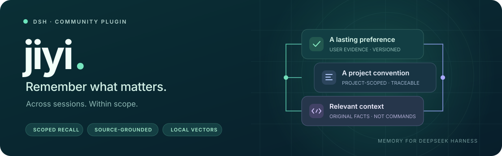

<div align="center">
  
  <h1>jiyi · 记忆</h1>
  <p><strong>让重要的事实留下来，让相关的上下文恰好出现。</strong></p>
  <p>为 DeepSeek Harness 带来可追溯、有边界的跨会话记忆。</p>
  <p><strong>简体中文</strong> · <a href="README.en.md">English</a></p>
  <p><a href="package.json">v0.1.39</a> &nbsp;·&nbsp; <a href="LICENSE">MIT</a> &nbsp;·&nbsp; <a href="https://github.com/topics/dsh-plugin">dsh-plugin</a></p>
  <p><a href="#核心能力">核心能力</a> · <a href="#工作方式">工作方式</a> · <a href="#快速开始">快速开始</a> · <a href="#配置">配置</a> · <a href="#验证">验证</a> · <a href="#常见问题">常见问题</a></p>
</div>

---

不必在每个新会话里重复交代项目约定。jiyi 在用户回合正常完成后后台整理有明确来源的长期事实，并从用户明确纠正、同类高信号失败第二次出现或明确 review/test/build 失败中提炼可复用的“教训”。教训只用于以后召回和提醒，不会自动修改项目代码。重要记忆按全局和当前项目范围自动载入，普通记忆通过中文和语义混合检索按需召回；输入框上方可以展开查看当前会话最近的已保存变化。

v0.1.39 修复审计发现的 P1 层缺陷：**4xx 与认证失败**曾被归为可重试的 `unknown`，密钥失效、模型名写错、余额不足都按 10 秒起指数退避重试到耗尽，面板显示「暂时性故障」而用户不知道该改配置；现在 4xx（429 除外）判为 `configuration` 立即失败并说明原因。**5xx 的识别**只测错误消息不测错误码，provider 写成 `HTTP502` 时认不出来；现在两者都测。**既有记忆达到约 100 条**时抽取输入必然突破 128 KiB，被判为不可重试的配置错误，该项目的记忆从此停止增长；现在按 120 KiB 预算裁剪上下文并把 `truncatedExisting` 写进状态。**被保护记忆的操作被跳过**时调用方仍记录成功，用户以为纠正已生效而实际零变更；现在返回 `skippedProtected`。**`/api/jiyi` 的错误码**曾一律 400，磁盘 `EACCES` 和数据库损坏都被说成参数错误；现在内部故障 500、`BUSY` 409。**巩固任务的租约 token** 曾随 `op=state` 原样下发；现在与冲突对象一样剥离。**`op=project` 的 `aliases`** 传字符串会被按字符拆成多个别名污染项目解析；现在要求字符串数组。**`scope:'all'`** 超过 2000 条时先丢的恰好是词法命中，与 `auto` 相反；现在统一词法在前。**教训提示词**说 `scope` 可省略，解析器却强制要求，导致整批失败重试；现在按提示词补 `project` 默认。**WAL/SHM** 补上 0600，**前台召回超时**不再写成重启后仍在的失败横幅。

偏好类矛盾的词法扫描**没有**落地：中文偏好句式高度同构，「我长期偏好中文回复」与「我长期偏好简洁报告」在 token 层面和「用 npm」与「用 yarn」一样相似，硬加会把健康记忆误推进待审。现在偏好只按 `factKey` 判冲突，理由记在 [`docs/DECISIONS.md`](docs/DECISIONS.md) D9。

v0.1.38 修复审计发现的云记忆正确性缺陷：**包含 "wrong" 的普通提问**曾被视为用户纠正，经 `user-correction` 证据直通覆盖现存记忆并绕过待审队列；纠正识别现在要求标记出现在消息开头并结束一个分句，误判不再可能覆盖事实，漏判只让该事实走正常复核。**一条无法打开的会话**曾让 `recovering` 集合永久非空，使待审裁决与离线巩固彻底停摆；恢复失败现在出队并记录原因。**重要记忆**曾在每个 step 重复追加，带工具调用的对话里上下文线性膨胀；现在按 `decision.messages` 去重。**更新记忆的 `factKey`** 曾静默把占用同键的另一条记忆置为已替代；现在抛 `MEMORY_CONFLICT`。**`op=settings`** 曾整体替换，提交一个段落会静默重置其余全部设置；现在按段落合并，只有空补丁 `{}` 才恢复默认。**待审记忆的普通更新**曾解散冲突组并把 `review_state` 改回 `clear`，让未裁决内容直接进入召回；现在拒绝并报 `CONFLICT_REVIEW_OPEN`，明确用户纠正与裁决落定仍可结案。**已结案的冲突组**曾被迟到的 worker 失败重新打开；现在终结态受保护。**裁决次数耗尽**的组曾永久停在 `open` 且无任何提示；现在写入 `last_error` 说明已用尽、等待人工裁决。**同一批整理里两条同 `factKey` 的新记忆**曾让整个事务回滚、其余记忆全部丢失；现在首条落库、其余转入待审。

v0.1.37 补齐工程文档：新增 [`docs/API.md`](docs/API.md)（`/api/jiyi` 的 op、参数边界、返回与错误码，以及 `jiyi_search` 工具和脱敏约定）、[`docs/DECISIONS.md`](docs/DECISIONS.md)（RRF 融合、MMR 打包、截止可缩短不可延长、v4 独立目录、冲突隔离、裁决探针语义化六项取舍的理由与代价）与 [`AGENTS.md`](AGENTS.md)（在本仓库干活要跑的命令、数据红线与禁止事项）。README 验证章补上实测日期、机器环境与命令；`.gitignore` 补 `*.pem` / `*.key` / `*.p12` / `*.pfx`，避免私钥随白名单放行入库。本轮无运行时代码变更，307 项回归在 2026-11-21 重跑通过。

v0.1.36 修复「真实验证裁决」在严格模型下无法通过的问题。裁决探针原先同时固定 `decision=same_claim_newer` 和模型自造的 `reasonCode=newer_user_evidence`，等于在考措辞而不是判断；现在给旧记忆更早的明确用户证据、候选更晚的证据，接受 `same_claim_newer` 或 `temporal_change`（store 两者同走替代旧记忆的路径），不再比对自由文本 `reasonCode`，并在一次不通过时重试。裁决子调用同时固定最低推理档：适配器默认高档时隐藏推理会吃光 900 的 `maxTokens`，流以 max-tokens 结束且没有任何 JSON。

v0.1.35 把召回排序从手调加权（`0.72·余弦 + 0.28·词法`）换成 RRF 排名融合：两个通道各自排名后按 `1/(60+rank)` 相加，余弦为 0 的关键词命中不再被另一个通道的量级压到底。打包阶段改用 MMR 贪心选取并给同一 `factKey` 设上限，六个槽位不会被同一事实的多个版本占满。生效期结束从「分数腰斩」改成只作同带内的时间衰减 tie-break。所有排序与预算数字集中导出为 `RETRIEVAL_CONSTANTS`，并新增 [`docs/INVARIANTS.md`](docs/INVARIANTS.md) 把 16 条不变量与守护测试对起来。前台召回截止改为「可缩短不可延长」（默认 3s，`embedder` 从未成功过时放宽到 10s）。修复了一处 lesson 整理路径上的失效调用，它会让重复失败的教训任务永远停在 `pending`。

v0.1.34 为记忆增加版本化证据与关系、结构化决策日志、事实有效期、待审冲突隔离、召回反馈和默认关闭的保守离线巩固。证据、失效版本、待审记忆与裁决过程都能在右侧栏查看；冲突未获得清晰用户证据和明确时间前不会进入自动召回。

此版本使用独立的 `storages/jiyi-v2` 数据目录，从空记忆开始；旧 `storages/jiyi` 保留，不自动导入。首次启动沿用可读取的旧模型设置，不改变账号凭据。重要记忆的内容预算为 8192 UTF-8 字节，用户指定的分类和手写记忆不会被后台整理覆盖。后台失败会按队列重试，并可在面板查看。

> [!NOTE]
> **本地保存，不等于完全离线。** 记忆、索引与 Embedding 在本机；提取和相关性判断会将所需内容发送给你配置的 LLM 提供方，使用已有授权。

后台提取和相关性判断使用配置的模型；其用量不再归入原任务的成本账本。

此版本面向已移除成本准入的 DSH Host。旧版带成本控制准入的 Host 可能因后台请求缺少成本归属而阻断提取或相关性判断；请使用匹配的 Host。

对历史纠偏或成本复盘暂停记录，jiyi 保留同任务接续识别；无法确认的跨原因接续继续保留来源，不将其归入其他任务。

## 核心能力

<table>
<tr>
<td width="33%"><strong>🧠 跨会话记忆</strong><br/><br/>在正常完成的回合后增量提取。保留用户来源、版本与替代关系，不批量导入全部历史。</td>
<td width="33%"><strong>🎯 有边界的召回</strong><br/><br/>默认检索全局与当前项目；明确引用其他项目时才扩展，歧义不自动合并。</td>
<td width="33%"><strong>🧾 原文支持度</strong><br/><br/>独立判断候选是否支持问项，并校验 <code>id / version / quote</code>，不补写未记录的细节。</td>
</tr>
<tr>
<td><strong>🗂️ 独立管理面板</strong><br/><br/>右侧栏新建独立记忆、查看来源、纠正或删除，管理项目别名、失败队列与模型设置。</td>
<td><strong>🔎 本地混合检索</strong><br/><br/>SQLite、FTS5 与384维 MiniLM 向量协同工作；相似度用于产生候选，不授权注入。</td>
<td><strong>🛠️ 自动优先，工具补充</strong><br/><br/>正常流程无需主模型主动搜索；<code>jiyi_search</code> 提供显式检索补充。错误与超时明确报告。</td>
</tr>
<tr>
<td><strong>📚 重复问题教训</strong><br/><br/>只从可信纠正、重复失败和明确检查失败中提炼，保存原因与以后做法；不自动修复代码，也不保存一次性环境错误。</td>
<td><strong>🔐 来源与隐私边界</strong><br/><br/>教训必须逐字引用真实来源；私密 Bot 会话、敏感凭据和未验证猜测不会进入长期教训。</td>
<td><strong>🎯 后续自动召回</strong><br/><br/>教训沿用普通记忆的项目/全局范围、相关性判断和来源校验，在以后相关任务中按需出现。</td>
</tr>
</table>

## 工作方式


1. **整理**：回合完成后，后台根据用户原文新增、更新或删除事实。明确纠正、重复出现的高信号失败，以及带真实工具证据的 review/test/build 失败可单独整理成教训；一次性环境错误和助手猜测不会保存为教训。
2. **筛选**：先限定项目范围，再用本地索引与向量产生候选。
3. **判断**：独立 LLM 判断原文对实际问项的支持度，严格验证逐字引用。
4. **补充**：注入带来源的原始事实，作为参考而非新指令；不是生成一条“新事实”。

<details>
<summary><strong>设计边界：什么时候不会注入？</strong></summary>

- 新用户输入时载入当前范围的重要记忆，并触发普通记忆的自动召回。
- 业务码不自动等于 HTTP 状态，表示约定不证明未记载的实现。明确否定、同义问法和混合问题中的已知部分可构成支持。
- 幻造、重复、过期或非法引用会失败；超时和错误不冒充“无相关记忆”，不会退回到相似度直接注入。
- 不把记忆中的命令当指令，不把助手推测当用户事实；同版本不重复注入，工具续步不递归召回。
- 纠正和删除影响后续检索，不抹除已有聊天中已经出现的文本。教训只保存错误模式和正确做法，不执行修复。

</details>

## 快速开始

### 0. 准备环境

| 需要 | 已验证环境 / 说明 |
| :--- | :--- |
| DSH 桌面端 | 需要已安装 DeepSeek Harness，依赖其 Host、LLM、工具与右侧栏 SDK |
| 系统 | macOS arm64；本版本不宣称其他平台已验证 |
| 运行环境 | Node 24.21、Electron 44；命令行中需有 Node 24 和 npm |
| 模型与账号 | 本地 MiniLM 资产；LLM 提供方的网络及已有授权 |

这是**桌面文件系统插件**，不是独立 Node 应用。已有安装请先备份插件、设置与 SQLite；不要直接覆盖数据目录。

### 1. 安装依赖与模型

```sh
export DSH_HOME="${DSH_HOME:-$HOME/.dsh}"
git clone https://github.com/yueyexiayu/dsh-jiyi.git "$DSH_HOME/plugins/jiyi"
cd "$DSH_HOME/plugins/jiyi"

npm ci --prefix deps
node scripts/prepare-models.mjs
```

安装器显式下载**固定 revision**，逐文件校验字节数与 SHA256；已有资产只做校验，错误会中止，不静默换模型。模型约129 MiB，首次下载需要时间。运行时禁止远程模型自动下载。

资源定义：[模型清单](<models/manifest.json>) · [依赖锁定](<deps/package-lock.json>) · [安装脚本](<scripts/prepare-models.mjs>)

### 2. 挂载为 desktop profile bundle

jiyi 作为 **desktop profile bundle** 加载。不要再用 `cordis.patch.yml` 的 `- insert:`；`insert` 已过时，本机不要用。同一 id 不要既做 bundle 又再 insert。

在 `$DSH_HOME/profiles/desktop/package.json` **两处**都加上 `jiyi`：

- `dependencies`：填写展开后的插件绝对路径，例如 `"jiyi": "link:/Users/<用户名>/.dsh/plugins/jiyi"`。JSON 中的 `$DSH_HOME` 不会自动展开。
- `dsh.profile.bundles`：字符串 `"jiyi"`，与包名相同

然后在该 profile 目录安装依赖，并确认 `node_modules/jiyi` 能解析到插件：

```sh
cd "$DSH_HOME/profiles/desktop"
npm install
node -e "console.log(require.resolve('jiyi'))"
```

不要再在 desktop `cordis.patch.yml` 里 `- insert:` 同一 id。需要改配置时只用对该 id 的 config 覆盖行。包内 [bundle 声明](<cordis.patch.yml>) 不要原样覆盖 desktop profile。

### 3. 重启并验证

**⌘Q 完全退出 DSH，再重新打开。** 从应用菜单“在浏览器中打开”进入正常认证入口，在右侧栏打开“记忆”：

- 确认 **Client / Host 均为 0.1.39**，Host 报 `schemaVersion=4`。
- 配置并分别验证提取、Embedding、相关性与冲突裁决模型。
- 「插件」页的 jiyi 详情里也能改同一份设置（不提供真实验证按钮，验证仍回「记忆」面板）。
- 保存设置不等于验证成功；不要分享带认证信息的浏览器链接。

## 配置

| 设置 | 默认值 | 用途 |
| :--- | :--- | :--- |
| 提取模型 | `deepseek-account/deepseek-flash` · 60000ms | 从明确用户证据中提取事实 |
| 教训整理 | 启用 · 同类失败第 2 次 | 复用提取模型生成来源可追溯的 lesson；只保存，不自动改代码 |
| 相关性模型 | `deepseek-account/deepseek-flash` · 10000ms | 独立判断候选对问项的支持度 |
| 冲突裁决 | `deepseek-account/deepseek-flash` · 15000ms · fixed | 固定或冻结当前会话实际路由；最低置信度默认 0.85 |
| 离线巩固 | 默认关闭 · 最少50条 · 24小时 · 单批5条 | 与提取队列分离；只在目标 Agent 空闲时后台运行 |
| Embedding | `Xenova/paraphrase-multilingual-MiniLM-L12-v2` | q8 CPU · 384维 · 本地运行 |
| 候选 / 最终记忆 | 最多12 / 6条 | 限制进入判别和注入的条数 |
| 候选语义阈值 | `0.20` | 只选候选，不授权注入 |
| 注入预算 | 4000 UTF-8字节 | 包含元数据、来源和包装 |

<details>
<summary><strong>数据位置与资源限制</strong></summary>

- 数据与设置位于 `$DSH_HOME/storages/jiyi-v2/`，目录/文件权限为0700/0600；不在 Git 仓库中。不要提交数据库、WAL、凭据、私人会话或原始评测记录。
- 管理面板按 200 条分页加载全部记忆；进入模型检索前使用 2000 条安全窗口，并在诊断中报告被截断数量。
- 自动整理和教训证据在发送模型前过滤常见凭据格式；删除手动新建或纠正的记忆时，同步清理对应 `manual:*` 审计正文。
- 记忆有效期区分 `as_of / interval / timeless / unknown`，`validTo` 为不含端点；历史迁移保留 `unknown`，不从正文猜测日期或时区。`lastConfirmedAt` 只来自最新有效用户或工具来源，不使用 `updatedAt` 冒充确认时间。
- 待审和已过期记忆不会进入自动召回、essential 注入或普通工具检索。普通历史查询仍可按项目范围读取替代版本。
- 每条版本写入证据定位与 quote SHA-256，并在同一事务维护 `supports / contradicts / corrects / derived_from` 关系。删除会清空正文、quote、候选内容和向量，但保留版本身份、来源定位、关系、决策与 quote hash。
- 冲突候选与提取队列分离。未裁决候选不会放宽事实键唯一索引；后台裁决缺失路由、超时、非法 JSON、虚构引用、版本竞态或隐私变化时保持隔离并记录真实失败。
- 召回记录提供“有用 / 不相关 / 错误”反馈，只有实际注入的同一会话记录可以反馈；`explicit_wrong` 只会触发复核，不直接改写正文。模型反馈只作为软信号，不能冒充可观测的因果使用。
- Provider 超时、繁忙和 5xx 使用分钟级退避与冷却；任务保留结构化阶段、错误类别、requestId 和最近 20 次尝试历史。召回面板按状态、失败阶段和延迟汇总，no-hit 明确视为正常零命中。
- API 为 `/api/jiyi`，走 DSH 正常认证；凭据保留在 Host，不发送到 Client。
- 模型冷加载默认上限120秒，单次推理与召回默认10秒；同一 Host 复用存活的隔离 Embedding 子进程，最多并发2个请求。过载、取消、超时和释放失败明确报告。
- 运行库锁定 `@huggingface/transformers@3.8.1`。模型、`node_modules` 与运行缓存不提交到 Git。
- LLM token 预算是否在服务端实施取决于提供方 adapter，不能把本地预算意图当作服务端硬限制。

</details>

## 验证

**最近一次实测**：2026-11-21，macOS arm64、Node 24、本机 MiniLM 资产，命令 `NODE_OPTIONS='' /usr/local/bin/node --test --test-timeout=90000 test/*.test.mjs`，实测 **319 / 319 通过**，失败 0、取消 0、跳过 0。下表其余各行是各版本发布时的历史记录，不是本次重跑结果。

| 验证类型 | 结果 | 如何理解 |
| :--- | :--- | :--- |
| 0.1.39 公开源码回归 · Node | **319 / 319** | 合成来源、受控 LLM，实际本地 Embedding / SDK；新增 5 条 P1 回归（错误分类、保护记忆可见、教训 scope 默认）；无失败、取消或跳过 |
| 0.1.38 公开源码回归 · Node | **314 / 314** | 合成来源、受控 LLM，实际本地 Embedding / SDK；新增 7 条审计回归（纠正识别、待审隔离、factKey 碰撞、冲突终结态、耗尽标记、设置合并）；无失败、取消或跳过 |
| 0.1.36 公开源码回归 · Node | **307 / 307** | 合成来源、受控 LLM，实际本地 Embedding / SDK；新增裁决探针回归；无失败、取消或跳过 |
| 0.1.35 公开源码回归 · Node | **306 / 306** | 合成来源、受控 LLM，实际本地 Embedding / SDK；无失败、取消或跳过 |
| 0.1.34 公开源码回归 · Node | **303 / 303** | 合成来源、受控 LLM，实际本地 Embedding / SDK |
| 0.1.33 公开源码回归 · Electron | **303 / 303** | 安装包内实际 SDK 与真实 ToolRuntime；无失败、取消或跳过 |
| 0.1.16 公开源码回归 · Electron | **186 / 186** | 历史结果：安装包内实际 SDK；无失败、取消或跳过 |
| 固定样本 · Q13 | **首次5 / 5** | 发布前的指定本机实测 |
| 固定样本 · 36题 | **36 / 36 × 2轮** | 未将旧正确应注入项变空；不是全场景保证 |

> 固定样本实测也使用 `deepseek-account/deepseek-flash`；私人原始数据不公开。受控回归测试不代替真实语义验证，也不代表所有模型或未来请求都同样可靠。
>
> 本机召回p50约 **1.43–1.45秒**，此前为1.18–1.23秒；准确性修复不等于性能提升。

<details>
<summary><strong>复现公开回归测试</strong></summary>

先安装依赖与模型，并确保 `/Applications/DeepSeek Harness.app` 和 `/usr/local/bin/node` 可用。测试使用独立临时 SQLite，不需要云端账号，不操作正式记忆。缺少桌面 SDK 或资产会明确失败，不当作通过。

```sh
NODE_OPTIONS='' /usr/local/bin/node --test --test-timeout=90000 test/*.test.mjs
ELECTRON_RUN_AS_NODE=1 NODE_OPTIONS='' \
  '/Applications/DeepSeek Harness.app/Contents/MacOS/DeepSeek Harness' \
  --test --test-timeout=90000 test/*.test.mjs
for file in lib/*.js scripts/*.mjs; do /usr/local/bin/node --check "$file" || exit; done
```

公开夹具独立于私有会话；`evidence/` 仅保留空目录占位，运行输出被忽略。当前相关性规则为 `jiyi-relevance-v9`，后台记忆整理版本为 `jiyi-review-v2`。Electron 测试覆盖安装包 SDK 与 ToolRuntime，但不能替代隔离 Host 中右侧栏和真实 SQLite 的运行验收。

</details>

## 文档索引

| 文档 | 回答什么 |
| :--- | :--- |
| [README.md](README.md) | 是什么、怎么装、怎么跑、怎么升级卸载 |
| [docs/API.md](docs/API.md) | `/api/jiyi` 的 op、参数、返回、错误码，以及 `jiyi_search` 工具 |
| [docs/INVARIANTS.md](docs/INVARIANTS.md) | 16 条必须始终成立的行为，及其守护测试 |
| [docs/DECISIONS.md](docs/DECISIONS.md) | 关键取舍的背景、决定与代价 |
| [AGENTS.md](AGENTS.md) | 在本仓库里干活的操作约定：命令、数据红线、禁止事项 |

## 常见问题

**关闭记忆面板会停止工作吗？**<br/>
不会。面板标签或文档不可见时暂停状态轮询，但不停止 Host；停用插件才停止提取与召回。

**必须让主模型调用搜索工具吗？**<br/>
不用。自动流程优先，`jiyi_search` 是显式检索的补充入口。

**更新、迁移和卸载怎么做？**<br/>
更新前备份插件与设置。v4 启动迁移在 SQLite 事务内执行，并在 v1/v2/v3 迁移前用 WAL 一致的 `VACUUM INTO` 备份；失败会关闭连接并恢复迁移前备份。迁移和开发验收必须使用临时 dataDir 或副本，不能拿正式 `jiyi-v2` 做演练。别名补登仍走 [显式迁移脚本](<scripts/migrate-aliases.mjs>)，先审阅计划和备份，不静默重写正式记忆。

卸载时从 desktop `package.json` 的 `dependencies` 和 `dsh.profile.bundles` 去掉 `jiyi`，删除已无用途的 `node_modules/jiyi` 链接，并去掉 desktop patch 里对该 id 的 config 覆盖（若有）。不要清空整个 patch。然后完全退出/重开 DSH。记忆数据是否保留由用户决定。

## 社区与许可

这是公开的 DSH 社区插件，已配置 description 与 `dsh-plugin` Topic；目录收录仍需对方审核，不代表官方自动安装或官方背书，没有自动提交自荐 PR。包名与 Host / Client bundle id 均为 `jiyi`，保留 `private: true`，不通过 npm 发布。

源码采用 [MIT License](<LICENSE>)。模型为独立的 Apache-2.0 资产，来源与固定revision见 [模型清单](<models/manifest.json>)；第三方依赖沿用各自许可。

<div align="center"><sub>记住事实，尊重边界。 · <a href="README.en.md">Read in English →</a></sub></div>
