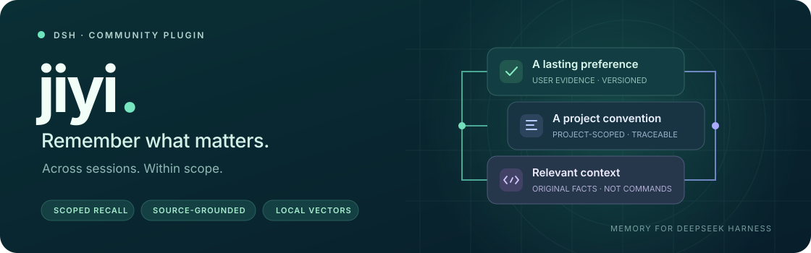

<div align="center">
  
  <h1>jiyi · 记忆</h1>
  <p><strong>让重要的事实留下来，让相关的上下文恰好出现。</strong></p>
  <p>为 DeepSeek Harness 带来可追溯、有边界的跨会话记忆。</p>
  <p><strong>简体中文</strong> · <a href="README.en.md">English</a></p>
  <p><a href="package.json">v0.1.18</a> &nbsp;·&nbsp; <a href="LICENSE">MIT</a> &nbsp;·&nbsp; <a href="https://github.com/topics/dsh-plugin">dsh-plugin</a></p>
  <p><a href="#核心能力">核心能力</a> · <a href="#工作方式">工作方式</a> · <a href="#快速开始">快速开始</a> · <a href="#配置">配置</a> · <a href="#验证">验证</a> · <a href="#常见问题">常见问题</a></p>
</div>

---

不必在每个新会话里重复交代项目约定。jiyi 会在用户回合正常完成后，后台提取**有明确来源的事实**；当新的相关输入到来，再按范围检索、独立判断支持度，补充原始记忆。它不是把全部历史塞进上下文，也不把“看起来相似”当作“足以支持回答”。

> [!NOTE]
> **本地保存，不等于完全离线。** 记忆、索引与 Embedding 在本机；提取和相关性判断会将所需内容发送给你配置的 LLM 提供方，使用已有授权。

配合支持后台任务归属的 DSH Host 和 chengben，新任务的后台提取用量归入产生该提取的原任务；晚到的用量不会转嫁到后续新任务。旧队列记录若缺少任务身份，其归属未知，不会凭猜测补记。后台请求未结算或用量未知时需要核查；为避免重复消耗，同一队列任务存在不确定的模型请求时不会自动再次派发，目前没有专用对账入口。已知结算后的提取或保存失败可重试，每次调用单独计量。

## 核心能力

<table>
<tr>
<td width="33%"><strong>🧠 跨会话记忆</strong><br/><br/>在正常完成的回合后增量提取。保留用户来源、版本与替代关系，不批量导入全部历史。</td>
<td width="33%"><strong>🎯 有边界的召回</strong><br/><br/>默认检索全局与当前项目；明确引用其他项目时才扩展，歧义不自动合并。</td>
<td width="33%"><strong>🧾 原文支持度</strong><br/><br/>独立判断候选是否支持问项，并校验 <code>id / version / quote</code>，不补写未记录的细节。</td>
</tr>
<tr>
<td><strong>🗂️ 独立管理面板</strong><br/><br/>右侧栏新建独立记忆、查看来源、纠正或删除，管理项目别名、失败队列与模型设置。</td>
<td><strong>🔎 本地混合检索</strong><br/><br/>SQLite、FTS5 与384维 MiniLM 向量协同工作；相似度用于产生候选，不授权注入。</td>
<td><strong>🛠️ 自动优先，工具补充</strong><br/><br/>正常流程无需主模型主动搜索；<code>jiyi_search</code> 提供显式检索补充。错误与超时明确报告。</td>
</tr>
</table>

## 工作方式


1. **记录**：从用户明确表达的事实中提取记忆，不采用助手推测。
2. **筛选**：先限定项目范围，再用本地索引与向量产生候选。
3. **判断**：独立 LLM 判断原文对实际问项的支持度，严格验证逐字引用。
4. **补充**：注入带来源的原始事实，作为参考而非新指令；不是生成一条“新事实”。

<details>
<summary><strong>设计边界：什么时候不会注入？</strong></summary>

- 打开会话时不预载具体事实；真实的新用户输入才触发自动召回。
- 业务码不自动等于 HTTP 状态，表示约定不证明未记载的实现。明确否定、同义问法和混合问题中的已知部分可构成支持。
- 幻造、重复、过期或非法引用会失败；超时和错误不冒充“无相关记忆”，不会退回到相似度直接注入。
- 不把记忆中的命令当指令，不把助手推测当用户事实；同版本不重复注入，工具续步不递归召回。
- 纠正和删除影响后续检索，不抹除已有聊天中已经出现的文本。

</details>

## 快速开始

### 0. 准备环境

| 需要 | 已验证环境 / 说明 |
| :--- | :--- |
| DSH 桌面端 | 需要已安装 DeepSeek Harness，依赖其 Host、LLM、工具与右侧栏 SDK |
| 系统 | macOS arm64；本版本不宣称其他平台已验证 |
| 运行环境 | Node 24.21、Electron 44；命令行中需有 Node 24 和 npm |
| 模型与账号 | 本地 MiniLM 资产；LLM 提供方的网络及已有授权 |

这是**桌面文件系统插件**，不是独立 Node 应用。已有安装请先备份插件、设置与 SQLite；不要直接覆盖数据目录。

### 1. 安装依赖与模型

```sh
export DSH_HOME="${DSH_HOME:-$HOME/.dsh}"
git clone https://github.com/yueyexiayu/dsh-jiyi.git "$DSH_HOME/plugins/jiyi"
cd "$DSH_HOME/plugins/jiyi"

npm ci --prefix deps
node scripts/prepare-models.mjs
```

安装器显式下载**固定 revision**，逐文件校验字节数与 SHA256；已有资产只做校验，错误会中止，不静默换模型。模型约129 MiB，首次下载需要时间。运行时禁止远程模型自动下载。

资源定义：[模型清单](<models/manifest.json>) · [依赖锁定](<deps/package-lock.json>) · [安装脚本](<scripts/prepare-models.mjs>)

### 2. 挂载为 desktop profile bundle

jiyi 作为 **desktop profile bundle** 加载。不要再用 `cordis.patch.yml` 的 `- insert:`；`insert` 已过时，本机不要用。同一 id 不要既做 bundle 又再 insert。

在 `$DSH_HOME/profiles/desktop/package.json` **两处**都加上 `jiyi`：

- `dependencies`：`"jiyi": "link:$DSH_HOME/plugins/jiyi"`
- `dsh.profile.bundles`：字符串 `"jiyi"`，与包名相同

然后在该 profile 目录安装依赖，并确认 `node_modules/jiyi` 能解析到插件：

```sh
cd "$DSH_HOME/profiles/desktop"
npm install
node -e "console.log(require.resolve('jiyi'))"
```

不要再在 desktop `cordis.patch.yml` 里 `- insert:` 同一 id。需要改配置时只用对该 id 的 config 覆盖行。包内 [bundle 声明](<cordis.patch.yml>) 不要原样覆盖 desktop profile。

### 3. 重启并验证

**⌘Q 完全退出 DSH，再重新打开。** 从应用菜单“在浏览器中打开”进入正常认证入口，在右侧栏打开“记忆”：

- 确认 **Client / Host 均为 0.1.18**。
- 配置并分别验证提取、Embedding 与相关性模型。
- 保存设置不等于验证成功；不要分享带认证信息的浏览器链接。

## 配置

| 设置 | 默认值 | 用途 |
| :--- | :--- | :--- |
| 提取模型 | `deepseek-account/deepseek-flash` · 60000ms | 从明确用户证据中提取事实 |
| 相关性模型 | `deepseek-account/deepseek-flash` · 10000ms | 独立判断候选对问项的支持度 |
| Embedding | `Xenova/paraphrase-multilingual-MiniLM-L12-v2` | q8 CPU · 384维 · 本地运行 |
| 候选 / 最终记忆 | 最多12 / 6条 | 限制进入判别和注入的条数 |
| 候选语义阈值 | `0.20` | 只选候选，不授权注入 |
| 注入预算 | 4000 UTF-8字节 | 包含元数据、来源和包装 |
| 状态陈旧时间 | 72小时 | 降低排序，而非删除 |

<details>
<summary><strong>数据位置与资源限制</strong></summary>

- 数据与设置位于 `$DSH_HOME/storages/jiyi/`，目录/文件权限为0700/0600；不在 Git 仓库中。不要提交数据库、WAL、凭据、私人会话或原始评测记录。
- API 为 `/api/jiyi`，走 DSH 正常认证；凭据保留在 Host，不发送到 Client。
- 模型冷加载默认上限120秒，单次推理与召回默认10秒；同一 Host 复用存活的隔离 Embedding 子进程，最多并发2个请求。过载、取消、超时和释放失败明确报告。
- 运行库锁定 `@huggingface/transformers@3.8.1`。模型、`node_modules` 与运行缓存不提交到 Git。
- LLM token 预算是否在服务端实施取决于提供方 adapter，不能把本地预算意图当作服务端硬限制。

</details>

## 验证

| 验证类型 | 结果 | 如何理解 |
| :--- | :--- | :--- |
| 0.1.16 公开源码回归 · Node | **184 / 184** | 历史结果：合成来源、受控 LLM，实际本地 Embedding / SDK |
| 0.1.16 公开源码回归 · Electron | **186 / 186** | 历史结果：安装包内实际 SDK；无失败、取消或跳过 |
| 固定样本 · Q13 | **首次5 / 5** | 发布前的指定本机实测 |
| 固定样本 · 36题 | **36 / 36 × 2轮** | 未将旧正确应注入项变空；不是全场景保证 |

> 固定样本实测也使用 `deepseek-account/deepseek-flash`；私人原始数据不公开。受控回归测试不代替真实语义验证，也不代表所有模型或未来请求都同样可靠。
>
> 本机召回p50约 **1.43–1.45秒**，此前为1.18–1.23秒；准确性修复不等于性能提升。

<details>
<summary><strong>复现公开回归测试</strong></summary>

先安装依赖与模型，并确保 `/Applications/DeepSeek Harness.app` 和 `/usr/local/bin/node` 可用。测试使用独立临时 SQLite，不需要云端账号，不操作正式记忆。缺少桌面 SDK 或资产会明确失败，不当作通过。

```sh
NODE_OPTIONS='' /usr/local/bin/node --test --test-timeout=90000 test/*.test.mjs
ELECTRON_RUN_AS_NODE=1 NODE_OPTIONS='' \
  '/Applications/DeepSeek Harness.app/Contents/MacOS/DeepSeek Harness' \
  --test --test-timeout=90000 test/*.test.mjs
for file in lib/*.js scripts/*.mjs; do /usr/local/bin/node --check "$file" || exit; done
```

公开夹具独立于私有会话；`evidence/` 仅保留空目录占位，运行输出被忽略。相关性规则为 `jiyi-relevance-v7`，提取器为v4。

</details>

## 常见问题

**关闭记忆面板会停止工作吗？**<br/>
不会。面板标签或文档不可见时暂停状态轮询，但不停止 Host；停用插件才停止提取与召回。

**必须让主模型调用搜索工具吗？**<br/>
不用。自动流程优先，`jiyi_search` 是显式检索的补充入口。

**更新、迁移和卸载怎么做？**<br/>
更新前备份插件与设置；运行中的 SQLite 使用 backup API 或安全一致性备份。从旧 topics/inbox 架构迁移，不可仅凭版本号假定无损。别名补登走 [显式迁移脚本](<scripts/migrate-aliases.mjs>)，先审阅计划和备份，不静默重写正式记忆。

卸载时从 desktop `package.json` 的 `dependencies` 和 `dsh.profile.bundles` 去掉 `jiyi`，删除已无用途的 `node_modules/jiyi` 链接，并去掉 desktop patch 里对该 id 的 config 覆盖（若有）。不要清空整个 patch。然后完全退出/重开 DSH。记忆数据是否保留由用户决定。

## 社区与许可

这是公开的 DSH 社区插件，已配置 description 与 `dsh-plugin` Topic；目录收录仍需对方审核，不代表官方自动安装或官方背书，没有自动提交自荐 PR。包名与 Host / Client bundle id 均为 `jiyi`，保留 `private: true`，不通过 npm 发布。

源码采用 [MIT License](<LICENSE>)。模型为独立的 Apache-2.0 资产，来源与固定revision见 [模型清单](<models/manifest.json>)；第三方依赖沿用各自许可。

<div align="center"><sub>记住事实，尊重边界。 · <a href="README.en.md">Read in English →</a></sub></div>
